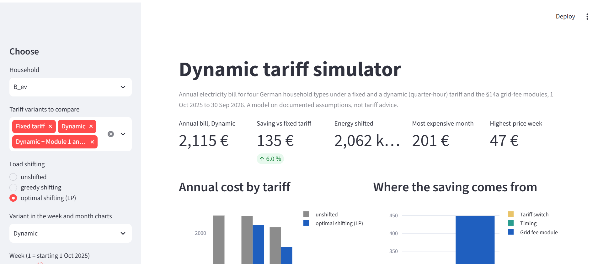

# Dynamic Tariff Simulator

Since October 2025 German day-ahead electricity prices are set per quarter-hour, and §14a EnWG lets
households with a heat pump or wallbox get time-variable grid fees. This project simulates, for four
synthetic household types over one year (Oct 2025 to Sep 2026, 35,040 quarter-hours), what a
dynamic tariff and the three §14a modules would cost compared with a fixed tariff, shifts EV and
heat-pump load to cheap quarter-hours under charging and comfort constraints (greedy rule and a
linear programme), and shows what happens to the grid peak when many households do the same.

**Result in short.** A standard household saves only **1.4%** (EUR 18 a year), because only about 41%
of the price is dynamic. With an EV or heat pump and optimal shifting the saving is **6.0% to 11.7%**,
and up to **19.9% to 27.0%** with §14a modules. If all households follow the same price, the peak of
1,000 households doubles (**4,947 kW against 2,423 kW**); random spreading over the 16 cheapest
quarter-hours removes the effect.


<!-- TODO (author): take the screenshot or GIF with `uv run ets app` and save it as docs/app.png -->

## Key findings

Annual bill and saving against the same household on a fixed tariff (benchmark 37.20 ct/kWh). Full
table with all variants and both methods: `DECISIONS.md` #28.

| Household | Dynamic, unshifted | Dynamic, LP-shifted | Best §14a variant, LP-shifted |
|---|---|---|---|
| A: standard, 3,500 kWh | EUR 1,284 (**1.4%**) | n/a (nothing to shift) | n/a |
| B: + EV, 15,000 km | EUR 2,247 (0.2%) | EUR 2,115 (**6.0%**) | Module 1 + 3: EUR 1,802 (**19.9%**) |
| C: + heat pump, 15,000 kWh heat | EUR 3,018 (5.6%) | EUR 2,825 (**11.7%**) | Module 1 + 3: EUR 2,448 (**23.4%**) |
| D: EV + heat pump + 8 kWp PV | EUR 2,767 (0.5%) | EUR 2,486 (**10.6%**) | Module 1 + 3: EUR 2,032 (**27.0%**) |

- Module 3 only pays when load is actually shifted into its low windows; unshifted it is worth about
  nothing (B: 0, D: -38 EUR).
- Greedy gets about 92% of the LP's timing saving for the heat pump and the same result for the EV.
- Herding (1,000 synthetic households, seed 42):

  | Scenario | Peak | Time of peak |
  |---|---|---|
  | unshifted | 2,423 kW | 2025-12-28 18:15 |
  | everybody shifts greedily | 4,947 kW (+104%) | 2026-01-01 23:15 |
  | EVs spread over the 16 cheapest slots | 2,433 kW | 2025-12-25 20:45 |

  With greedy shifting the peak is in the cheapest quarter-hour of the night on 74% of nights. The new
  peak exceeds today's above about 40% adoption (estimate). Spreading costs the EV 19% of its saving.

## Architecture and stack

```
SMARD API ─┐                      ┌ dbt models (DuckDB)           ┌ billing, §14a
OPSD       ├─> bronze (raw files, ├─> silver (UTC, ct/kWh, DST) ─>├ greedy + LP shifting ─> sim_* tables ─> Streamlit app
when2heat  │    manifest)         └ gold (quarter-hour facts)     └ herding aggregation   herding_* tables
BDEW H25  ─┘
```

Python 3.12+, uv, DuckDB, dbt-duckdb, Polars, PuLP with HiGHS, Streamlit, pytest, ruff, GitHub Actions.
All inputs and assumptions are in `config/*.yaml` (validated by typed models); every run records its
config hash and git version in `sim_runs`.

**What I deliberately did not use.** Spark and Airflow: one year is 35,040 quarter-hours, DuckDB and
Parquet handle that in seconds; I can say at what scale I would add them. Postgres: no concurrent
writers, one analytical file is enough. A solver for the greedy case: greedy is the baseline the LP is
checked against. Price forecasting: both optimisers know the day's prices (see limits).

## Data sources and licences

| Source | Use | Licence (checked 2026-10-25) |
|---|---|---|
| [SMARD](https://www.smard.de) (Bundesnetzagentur), day-ahead price DE-LU, quarter-hour | prices | CC BY 4.0, credit "Bundesnetzagentur \| SMARD.de". SMARD's [data-use page](https://www.smard.de/en/datennutzung) ties CC BY 4.0 explicitly to the market-data downloads; other SMARD pages state it for all downloads, and the general Bundesnetzagentur imprint names the "Datenlizenz Deutschland - Namensnennung 4.0" for xls/csv files. This project reads the SMARD chart-data API, not those downloads, so attribution is given and the exact licence of the API output is not unambiguously stated. |
| [Open Power System Data household_data](https://data.open-power-system-data.org/household_data/) (2020-04-15), CoSSMic households | shapes of EV, heat pump and PV | CC BY 4.0 (stated on the 2017 package pages; I did not find the licence line for the 2020 version in the text I could retrieve, so check its `datapackage.json`) |
| [OPSD when2heat](https://data.open-power-system-data.org/when2heat/) (2023-07-27) | heat demand profile and COP | data CC BY 4.0, scripts MIT. Ruhnau, Hirth, Praktiknjo (2019), *Scientific Data* |
| [BDEW standard load profiles](https://www.bdew.de/energie/standardlastprofile-strom/) H25 (2025) | base load shape | **No licence or redistribution terms are stated on the BDEW page** (only a generic site copyright). The file is downloaded by `ets ingest`; `data/sample/staging/bdew_profiles_long.csv` in this repository is a small reshaped extract for CI. Terms unverified; remove it and download in CI if BDEW objects. |
| BDEW Strompreisanalyse 08/2026, network-operator price sheet, supplier figures | price components and §14a values in `config/` | published figures typed into config with the source named in the file; some are from secondary sources (`DECISIONS.md` #7, #8) |

## How to run

```
make setup        # uv sync
make all          # ingest (about 8 min, about 400 MB), transform, simulate; then `uv run ets herding`
make app          # Streamlit, or: uv run ets app
make test         # pytest and ruff
```
`make` is optional; every target is a `uv run ets ...` command (see `Makefile`). A clean run from an empty
`data/` folder takes about 12 minutes. `uv run ets refresh` fetches the newest prices (also run daily by
`.github/workflows/refresh_prices.yml`). CI (`ci.yml`) runs ruff, pytest and `ets transform` on the
357 KB sample in `data/sample/`, so it never calls a live API.

## Assumptions and limits

All assumptions are listed with reasons in `DECISIONS.md` (index in its header). The ones that matter most:

- Optimisers have **perfect foresight** of the day's prices and ignore real-world frictions: savings are an
  upper bound. Days are planned independently; no standing losses in the heat buffer, no vehicle-to-grid.
- Households are **synthetic**: OPSD data come from a few German households of 2014-2017, aligned to the 2025/26
  calendar; EV 15,000 km at 18:00-07:00, heat pump 15,000 kWh heat with a 10 kWh buffer, PV 8 kWp. EV and heat-pump
  shares in the herding run (30% / 20%) are assumptions.
- The **optimisers are PV-blind**, so household D's results are conservative; its LP bill is worse than greedy
  (`DECISIONS.md` #29).
- Module 3: the operator's sheet lists a EUR 80 yearly metering-point price that is not included; if it applies,
  Module 3 results drop by about EUR 95 (#26). Smart-meter fees and supplier figures come from secondary sources.
- Herding has **no grid topology**: it is the sum over 1,000 households, with everybody following the same price,
  which is the worst case. The partial-adoption numbers are an estimate from blending stored curves.
- Type-A sanity check: 1.4% lies in the plan's expected range of 1-3%. Fixed benchmark 37.20 ct/kWh is rebuilt from
  components, not a quoted supplier tariff.
- The GitHub workflows were validated locally but have not run on GitHub yet.

## What I would do next

Price forecasting instead of perfect foresight, a PV-aware optimiser, a home battery, CO2 intensity from the
SMARD generation mix, a FastAPI endpoint for single-household queries, feeder-level herding with real topology.
